# portkit for the bitbox micro: manual

This manual covers what portkit adds to the 1010music **bitbox micro** firmware 2.3.4 (build **2.3.4-pkZD**).
Everything else works as in the stock firmware; see 1010music's own manual for that.
Also as a PDF: [portkit-micro-manual.pdf](portkit-micro-manual.pdf).

The screenshots come from the simulation of the patched firmware, so they show exactly this build. On the unit the
screen looks the same; the pad names here are just the file names of the demo card.

**Contents**

1. [Install and check](#1-install-and-check)
2. [Getting around](#2-getting-around)
3. [Pads 9–16](#3-pads-916)
4. [Sound: Fidelity, Drive, Filter 2](#4-sound-fidelity-drive-filter-2)
5. [Clips: Shift, Play Len, Stretch, Loop Fade, Sync 1/32](#5-clips-shift-play-len-stretch-loop-fade-sync-132)
6. [Effects: reverb types and FX3](#6-effects-reverb-types-and-fx3)
7. [Master section: compressor and distortion](#7-master-section-compressor-and-distortion)
8. [Recording](#8-recording)
9. [Presets, going back, troubleshooting](#9-presets-going-back-troubleshooting)

---

## 1. Install and check

1. Get the stock firmware **2.3.4** from 1010music and take `MICRO.BIN` out of the zip. Keep a copy.
2. Open the [patcher page](https://kyrillleier-jpg.github.io/portkit-micro/), drop the stock `MICRO.BIN` on it and
   download the patched `MICRO.BIN`. It runs in your browser; nothing is uploaded.
3. Copy the patched `MICRO.BIN` to the root of the microSD card.
4. Hold the **white right arrow** key while switching the unit on.

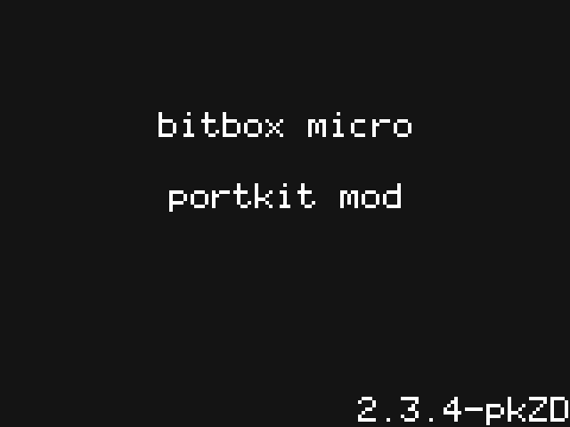

The splash screen shows **portkit mod** and the version **2.3.4-pkZD**. The version is also at the top of the Tools
settings page.

## 2. Getting around

portkit uses the unit's normal controls:

| Control | What it does |
|---|---|
| **HOME** | cycles the main screens: Pads → Mixer → Effects (FX) |
| **TOOLS** | cycles the Tools screens: Settings → Input → Output |
| **Left / right arrow** | pages within a screen (pad pages, master pages, pads 1–8 / 9–16) |
| **Touch** | select a pad, a cell or a list row; swipe a list to scroll it |
| **Encoder** | change the selected value |

A pad's settings: select the pad, then press the **right arrow** (waveform), and again (parameter list). The
**page menu** icon (the dots, second from the left in the pad header) opens the list of parameter pages:

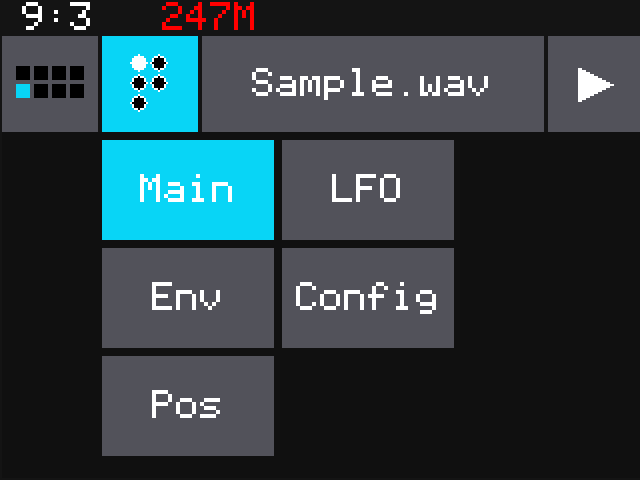

| Page | portkit additions on it |
|---|---|
| **Main** | Filter 2, Res 2, Drive (all pad modes); the 24 dB filter |
| **Config** | Fidelity (renamed from Interp, with the vintage sampler modes) |
| **Pos** (Clip pads) | Shift ms, Play Len, Stretch %, Str Mode, Loop Fade; Sync 1/32 |

## 3. Pads 9–16

The pad grid has a second page: pads 9–16.

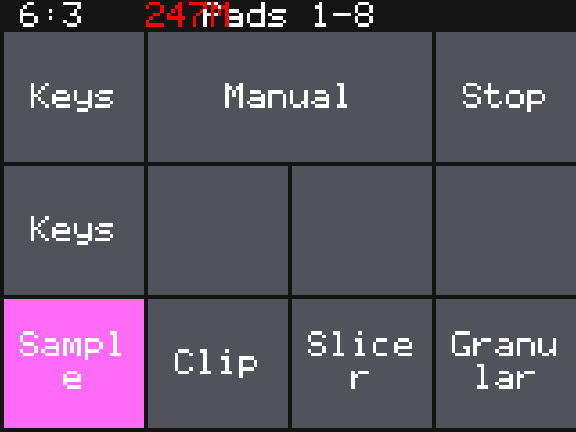 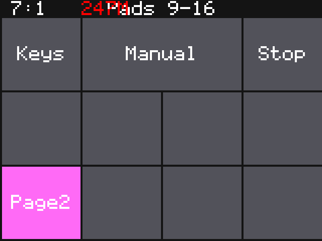

- **Pads screen:** the **left arrow** switches between *Pads 1-8* and *Pads 9-16* (shown in the title).
- **Effects screen:** the left arrow switches its pads the same way (*FX 1-8* / *FX 9-16*).
- **Mixer:** tap the field at the top left.
- **Pad picker** (the grid icon at the left of a pad's header): the left arrow shows the other page.

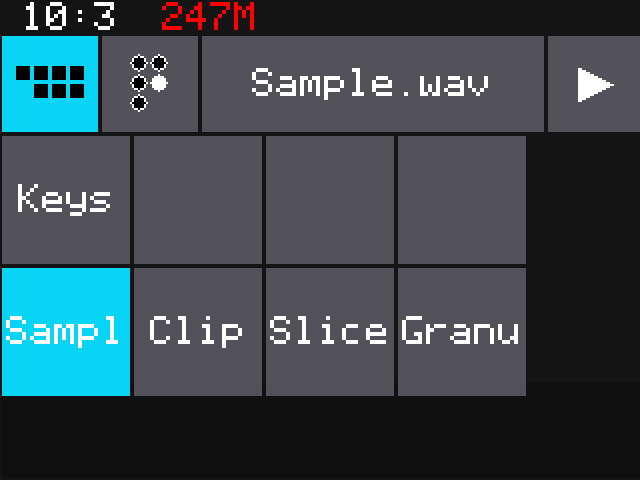 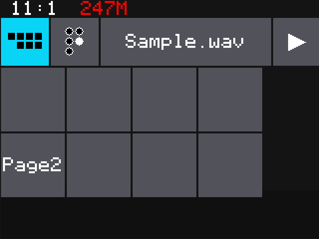

Pads on page 2 work like pads 1–8 and are saved with the preset.

## 4. Sound: Fidelity, Drive, Filter 2

### Fidelity

On every pad mode (Sample, Clip, Slicer, Granular): page menu → **Config** → **Fidelity**.

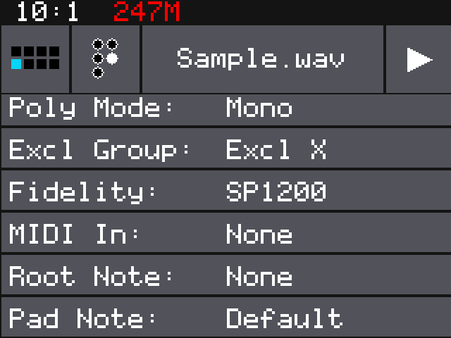

| Setting | Sound |
|---|---|
| Normal, HighQ | as stock (stock interpolation) |
| SP1200, SP-12, S950, MPC60, SP Raw | machine modes voiced after those vintage samplers |
| 16k, 12k, 10k, 8k, 6k, 4k, 2k | plain sample-rate reduction to that rate, 12 bit, no anti-aliasing filter |

The reduction happens before the pad filter, so the filter can tame the grit.

### 24 dB filter, Drive, Filter 2

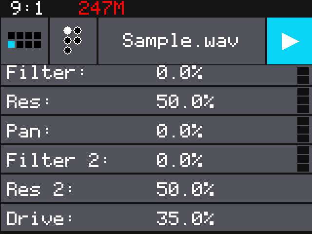

- **Filter / Res** (stock controls) now drive a 24 dB/octave state-variable filter instead of the stock 12 dB one:
  left of centre low-pass, right of centre high-pass, centre off. The resonance stays clean.
- **Drive**: soft saturation (tanh) before the filters, 0..100 %.
- **Filter 2 / Res 2**: a second 24 dB filter in series, same behaviour as Filter / Res. Use both for a steeper
  slope or a band-pass (one low-pass, one high-pass).

Scroll the Main page list (swipe up) to reach Filter 2, Res 2 and Drive. Old presets open with Drive 0 and Filter 2 off.

## 5. Clips: Shift, Play Len, Stretch, Loop Fade, Sync 1/32

On a **Clip** pad: page menu → **Pos**, then scroll down.

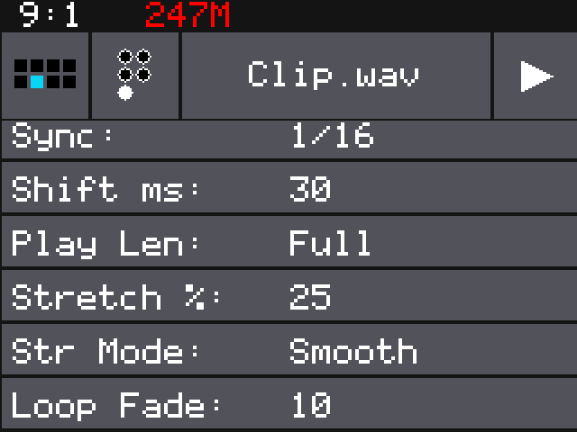

| Control | Range | What it does |
|---|---|---|
| **Sync** | adds **1/32** | finer re-trigger grid for clips |
| **Shift ms** | −100..+100 ms | moves the audio against the loop: the loop keeps its length and grid position, its content rotates. For loops that start slightly early or late |
| **Play Len** | Full, 1/4..32 bars | plays only that length of the clip, in quarter-bar steps |
| **Stretch %** | −100..+100 % | plays the clip slower or faster than its natural tempo |
| **Str Mode** | Auto / Jump / Smooth | how Stretch works: *Jump* skips through the clip in segments (keeps transients, can stutter), *Smooth* time-stretches without changing the pitch (WSOLA), *Auto* = Smooth whenever Stretch is not 0, otherwise the stock playback |
| **Loop Fade** | 0..50 ms | a short dip at the loop start, loop end and the Shift seam against clicks |

Play Len and Stretch need **Sync**: with Sync set to *Slice* or *None* they have no effect and are hidden, as are
they when Quant Size makes them ineffective.

## 6. Effects: reverb types and FX3

Press **HOME** until the Effects screen (*FX 1-8*) shows. The top row holds the effect cells, below are the pads.

### Reverb types

Tap **RVB**, then the **right arrow**:

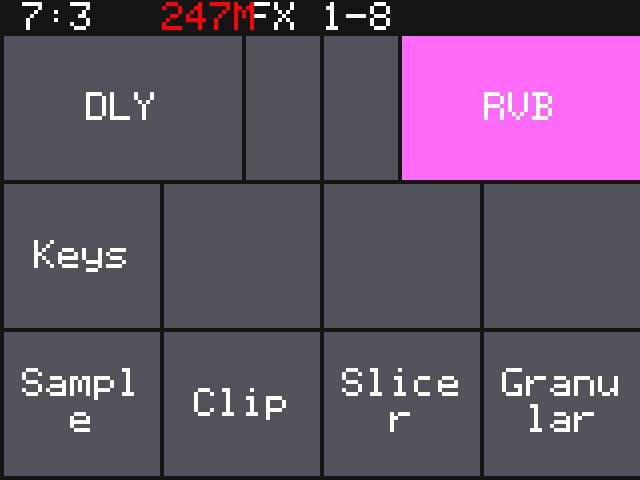 

**Type**: Plate (stock), Room, Hall, Chamber, each with its own settings (scroll the list) and a **Level** control.
The types are level-matched to the plate.

### FX3: a third send

FX3 is a second, independent reverb on its own send, e.g. a short room on the drums and a long hall on the synths.

- On the Effects screen, **tap the selected RVB cell again**: it switches to **FX3** (and back).
- While FX3 is shown, the pads below show and set each pad's **FX3 send**, as they do for DLY and RVB.
- **Right arrow** opens the FX3 settings. The page is titled with the reverb type (FX3 is a reverb), it has the same
  types and settings as RVB.
- **Right arrow again** opens the **master EQ**.

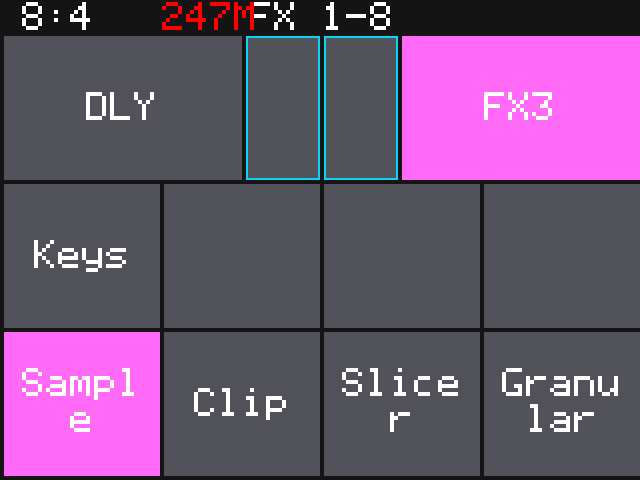 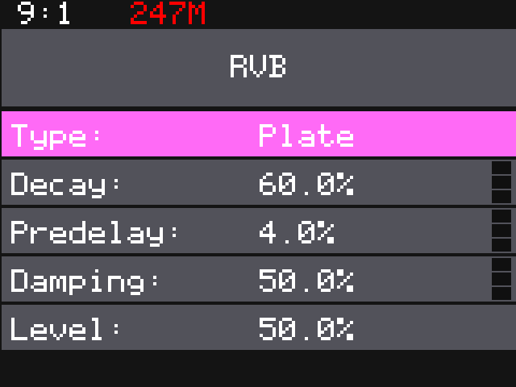

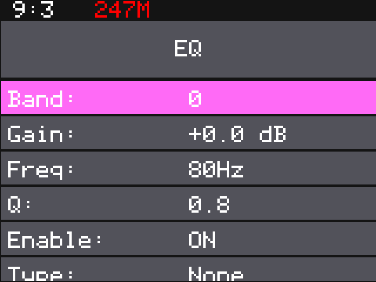

## 7. Master section: compressor and distortion

Press **TOOLS** for the Settings page (the version is at the top). From there:

- **Left arrow**: the **compressor page**
- **Right arrow** (from the compressor page, twice): the **distortion page**

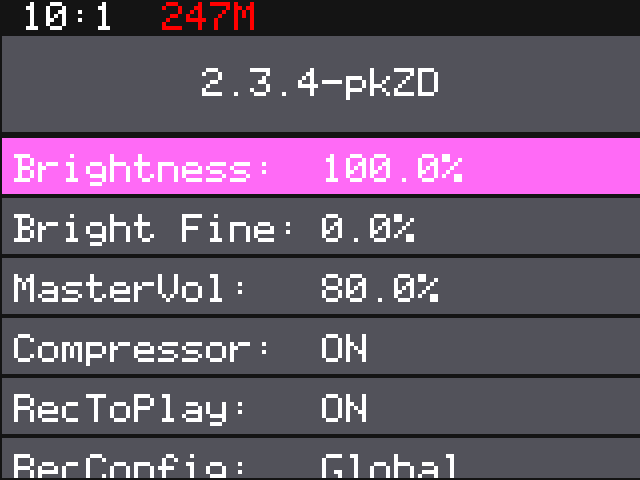

### Compressor

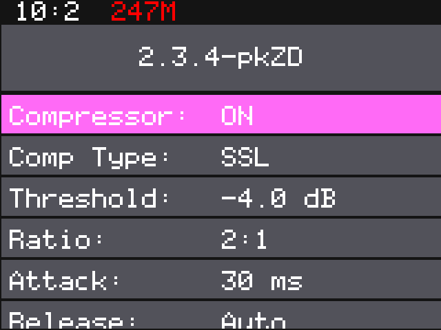

| Control | Stock type | SSL type |
|---|---|---|
| **Compressor** | on / off (the stock switch) | |
| **Comp Type** | Stock: the firmware's own compressor | SSL: a bus compressor modelled on the SSL console's |
| **Threshold** | dB | dB |
| **Ratio** | 1:1 .. 20:1 | 2:1, 4:1, 10:1 |
| **Attack** | 1 .. 200 ms | 0.1 / 0.3 / 1 / 3 / 10 / 30 ms |
| **Release** | 10 .. 2000 ms | 0.1 / 0.3 / 0.6 / 1.2 s or **Auto** (program dependent) |
| **Gain** | make-up gain, −12 .. +24 dB | same |
| **Mix** | dry / compressed blend (parallel compression) | same |

The compressor works on the main output after the effects and the distortion.

### Master distortion

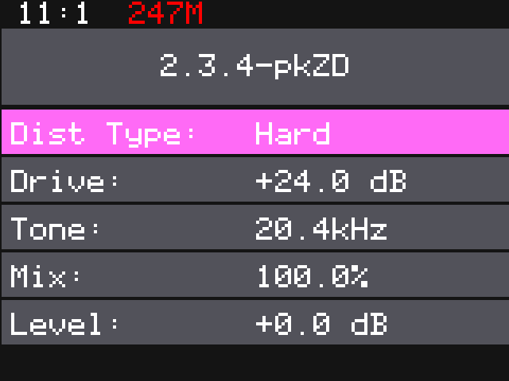

| Control | What it does |
|---|---|
| **Dist Type** | Off, Soft (tanh saturation), Hard (clipping), Fold (triangle wave folding), Tube (asymmetric saturation) |
| **Drive** | input gain into the distortion, 0 .. +36 dB |
| **Tone** | low-pass after the distortion, fully open at the top (20.4 kHz) |
| **Mix** | dry / distorted blend |
| **Level** | output level, −24 .. +12 dB |

It runs with 2x oversampling on the main output (Out 1/2), after the effect returns and the master EQ and before the
compressor, whether the compressor is on or off.

## 8. Recording

Recording works as in the stock firmware, with two changes:

- A pad's **FX1 / FX2 / FX3 sends stay** as they were when you record into it (the stock firmware reset them).
- The **input monitor** goes through the sends of the selected pad, so you hear the input with the effects it will
  have.

## 9. Presets, going back, troubleshooting

- **Presets:** values are stored by name. Presets from the stock firmware load as before; the new controls start at
  their defaults (Fidelity Normal, Drive 0, Filter 2 off, Shift 0, Play Len Full, Stretch 0, FX3 send 0, distortion
  Off, compressor type Stock).
- **Going back to stock:** the same install steps with the stock `MICRO.BIN`. Presets saved with portkit contain
  extra values the stock firmware does not know; how stock treats them has not been tested, so keep a copy of
  presets you care about.
- **The patcher page says "not the stock MICRO.BIN":** the file is not the unmodified 2.3.4 (another version, or
  already patched). Take a fresh copy out of 1010music's 2.3.4 zip.
- **Play Len / Stretch are missing on the Pos page:** set Sync to a note value (not Slice or None).
- **Problems:** please open an issue on [GitHub](https://github.com/kyrillleier-jpg/portkit-micro/issues) with the
  build (2.3.4-pkZD) and what you did.

---

*Screenshots: `python3 -I tools/manual_shots.py` (Renode simulation of the patched build). PDF: `tools/manual_pdf.py`.*
*Unofficial community firmware, not affiliated with 1010music.*
